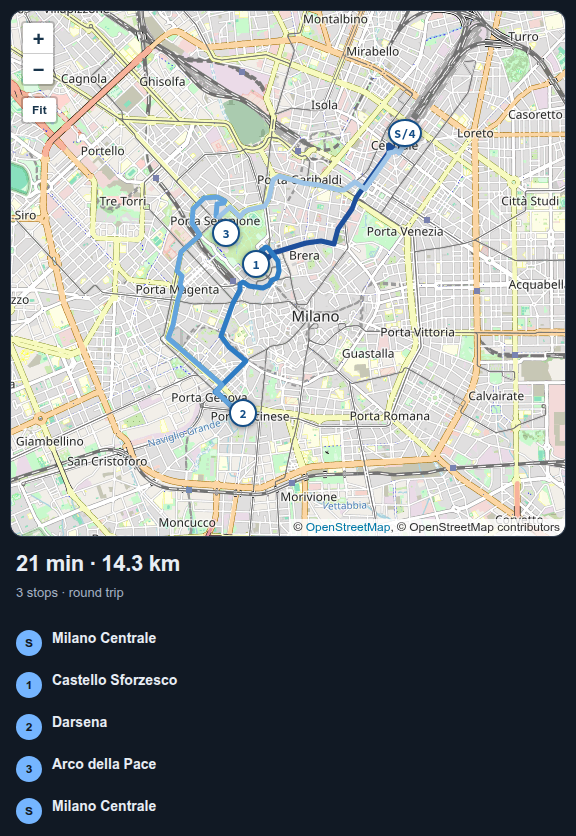
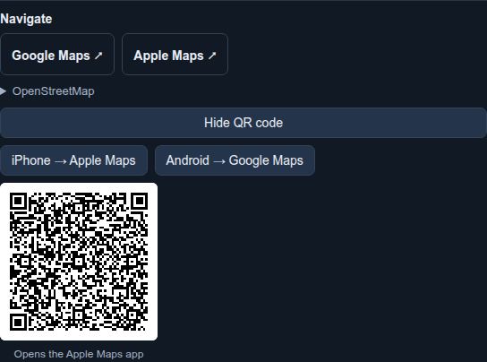
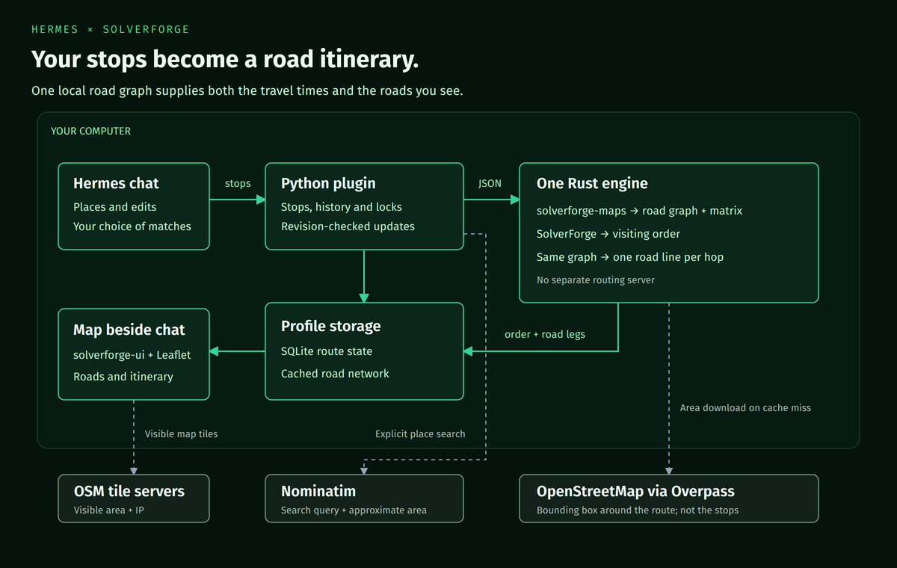

# SolverForge Routing for Hermes

<p align="center"></p>

Tell Hermes where you need to go. A constraint solver chooses a visiting order, and the road route opens beside your conversation.



A list of stops is not a driving route. The fastest order depends on which streets connect, which way you can drive them, where you start and where you need to finish. This plugin gives Hermes a [SolverForge](https://solverforge.org) solver and a local road graph. You supply the places; Hermes resolves them, the solver orders the visits, and the map shows the actual roads between them.

Adding a stop does not mean starting over. Tell Hermes what changed and it repairs the remaining trip, keeping your visited stops, your next visit and any ordering rules.

## Try it

You need [Hermes Agent](https://github.com/NousResearch/hermes-agent) 0.22.2 or newer.

```sh
hermes plugins install blackopsrepl/hermes-solverforge-routing --enable
hermes solverforge-routing install
```

The second command downloads the routing engine for your computer and checks it against a fingerprint pinned in the plugin. There is nothing else to install: no Rust, no routing server, no account.

If you already use Hermes, run `hermes chat -q hi` once after installing, then ask. Current Hermes builds a session's tool list from the plugins it saw at the previous launch, so the session right after an install has no routing tools. In the Desktop app, restart it after installing, then ask:

> Start at Milano Centrale. I need to visit Castello Sforzesco, the Darsena and Arco della Pace, then come back to the station. Find a better order.

Hermes asks you to choose when a place is ambiguous. Once the places are confirmed, it solves and shows the map beside the chat. Pan, zoom or press **Fit** to see the whole trip. The start is **S**; the visits are numbered in driving order.

The first solve in a new area downloads its roads from OpenStreetMap. A city-to-city area can take a minute or two; subsequent solves reuse the local cache. It does not need a separate routing server.

The map can also be opened from the **Route** status-bar chip or the command palette. Edit the trip by talking to Hermes, not by leaving the conversation for another form.

## What you can ask

| You say | What happens |
| --- | --- |
| “Visit these places and come home” | Orders the visits and returns to the original starting point |
| “Finish at the station instead” | Keeps a fixed destination rather than returning home |
| “Go to the pharmacy first” | Locks your next visit |
| “Visit the supplier before the warehouse” | Preserves that order while searching the other possibilities |
| “Add the hardware store” | Finds the place, confirms it and repairs the trip |
| “Skip the museum” | Removes that visit and repairs what remains |
| “I've been to the castle” | Records it as visited and advances the starting point; home stays where the trip began |
| “I'm starting somewhere else now” | Uses the location you give; it never guesses from your IP |
| “Show me the route” | Opens the map beside the conversation |

This is a personal, single-vehicle trip planner, not fleet dispatch. It does not track where you are or decide that you have arrived.

## What you get

**Roads, not straight lines.** [solverforge-maps](https://github.com/SolverForge/solverforge-maps) builds a road graph from OpenStreetMap. The same graph supplies the travel-time matrix and each hop's geometry, so the map never has to guess where a visit begins or ends.

**The map reads like your trip.** The leg you are driving is the bold line; the hops still ahead stay pale, and on a round trip the dashed amber line closes back to your amber start marker — direction stays legible where lines cross or share a road.

**Your rules kept intact.** Every remaining stop must be visited exactly once. A fixed next visit, a fixed destination and “before” rules are checked independently before a solution can replace the current route. An older solve cannot overwrite an edit made while it was running.

**An honest comparison.** When the result saves at least a whole minute against the order you gave, the pane says how much. Both orders use the same road matrix and the same start/end convention. If your original order breaks a lock, no saving is claimed against it. These are best-found estimates, not a claim of a proven global optimum.

**A trip that changes with you.** After an edit, the result explains which visits were added, removed, visited or moved, and how the estimated driving time changed. Visited history is retained.

**A map that stays with the conversation.** [solverforge-ui](https://github.com/SolverForge/solverforge-ui) and Leaflet display the roads in a sandboxed pane. Numbered stops match the itinerary underneath. The map is a viewer; Hermes remains the input.

**A handoff to your navigation app.** Open the itinerary in Google Maps, Apple Maps or OpenStreetMap, or send it to your phone: pick the phone kind (Apple or Google) and scan the single QR on screen — the Apple code opens the Apple Maps app on an iPhone, the Google one suits Android. One code is ever on screen, so the camera has exactly one target. A trip longer than the app accepts in one link is split into parts rather than silently dropping stops; scan part 1, then press **Next part** for the next code. The navigation app calculates its own route using its own road data.



## Know before you drive

This is not turn-by-turn navigation. There is no live traffic, road-closure feed, arrival detection or automatic rerouting as you drive.

The current road model handles one-way roads, roundabouts, motorway links and basic car-access tags. It does **not** yet enforce turn restrictions, barriers or conditional access. It also does not distinguish destination-only streets from through streets. Check the route in your navigation app and follow signs and current road conditions.

Road direction arrows are not shipped yet. The current map uses numbered stops and hop colours; arrows are being developed in solverforge-ui rather than patched into this plugin.

## Places and shared locations

Give Hermes an explicit city or region with your place names. Searches happen only when requested, not on every keystroke. Results include the type of place, its locality and distance from your starting point. A railway station and a nearby company with a similar name are not treated as interchangeable.

For a list of places, Hermes prepares one batch for review. Clear matches may be suggested; ambiguous or distant ones need your choice. Nothing is added until you confirm, and unresolved places are never silently omitted.

You can also supply coordinates or share a location pin through a supported messaging gateway. A pin is a one-time starting point, not permission to track you. Desktop does not supply automatic geolocation. Live-location messages are not treated as tracking updates.

## What it downloads, runs and stores

| Action | What leaves your computer |
| --- | --- |
| Search for a place | The query, region and approximate search area go to Nominatim |
| Solve in a new area | A bounding box goes to Overpass to download OpenStreetMap roads; the stop list itself is routed locally |
| View, pan or zoom the map | Tile requests reveal the visible area and your IP to OpenStreetMap tile servers |
| Open a navigation link or scan its QR code | The linked stop coordinates go to the provider you chose |

Nominatim and Overpass are public services with no availability guarantee. Do not send confidential addresses to the public geocoder. A Nominatim-compatible HTTPS endpoint can be selected with the `geocoder_url` plugin setting. Searches are paced and cached; there is no autocomplete, IP-based location inference or background searching.

The Rust engine runs once per solve with JSON input and output. Road downloads happen inside [solverforge-maps 2.3.3](https://crates.io/crates/solverforge-maps/2.3.3); stop ordering uses SolverForge 0.24.0. No shell is used to run a solve.

Everything lives under `<hermes home>/plugin-data/solverforge-routing/`: the route database, road cache and installed engine. Data is isolated by Hermes profile. Removing the plugin keeps that folder so a reinstall can find your trip; delete it to erase the stored data. There are no account credentials or telemetry.

Road and tile data © [OpenStreetMap contributors](https://www.openstreetmap.org/copyright). Search uses [Nominatim](https://nominatim.org/); road downloads use [Overpass](https://overpass-api.de/).

## How it works



- **Hermes** resolves the places with you and translates your requests into route edits.
- **The Python plugin** owns profile-specific state, revisions, visited history and navigation handoffs.
- **The Rust engine** uses solverforge-maps for the road graph and travel matrix, then SolverForge for the visiting order. It returns one road line per hop from that graph.
- **The map pane** uses solverforge-ui inside Hermes's public sandbox. No Hermes core patches, guessed gateway URLs or executable CDN dependencies.

The engine's native constraints are checked again before publication: endpoints, complete stop coverage, fixed-next rules, precedence and the reported cost. A feasible solution is labelled best-found, never proven shortest.

## Development

To run from a checkout you need Rust 1.95+, Python 3.12, uv and Node/npm.

```sh
make engine        # Build the Rust engine
make install-dev   # Install this checkout's HEAD into Hermes, using the local engine
make check         # Engine, Python, Desktop render and Hermes package checks
make images        # Re-render the banner and architecture from editable HTML
make screenshots   # Re-capture the README screenshots
```

Set `CARGO_TARGET_DIR` to keep Rust build artifacts outside the checkout. Offline Python tests use a clearly labelled test-only engine over synthetic roads; solver tests run inside the real Rust engine. The opt-in [browser flow](tests/browser/README.md) runs Chromium against the real REST API and native engine with live road data and tiles. It does not stand in for checking the installed Hermes Desktop.

The screenshot generator uses public Milan landmarks and a throwaway profile, never a user's saved route. See [`scripts/capture-screenshots.py`](scripts/capture-screenshots.py). Banner and architecture sources are in [`docs/assets/`](docs/assets/).

Engine builds and plugin releases are separate: `engine-vX.Y.Z` produces platform binaries and provenance; `vX.Y.Z` publishes the plugin only after its pinned checksums match the engine release. Source lives in [`engine/`](engine); release automation lives in [`.github/workflows/`](.github/workflows/).

## License

[Apache-2.0](LICENSE). Vendored libraries retain their own licences and provenance under [`assets/map/`](assets/map/) and [`vendor/`](vendor/).
